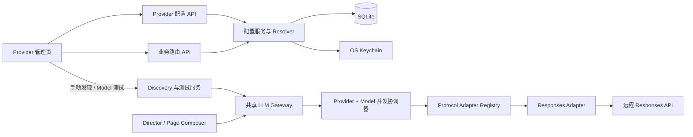

# API Provider 管理改进方案

版本：1.1
日期：2026-11-06
状态：已实现首版闭环；原始方案与落地决策对照

## 0. 实现交付与落地决策（2026-11-06）

分支：`feat/provider-management`。本节描述最终实现；第 1–13 节保留需求和原始设计，遇到存储、目录、迁移工具等差异，以本节和当前代码为准。

### 0.1 已交付闭环

- `/settings/providers`：多 Provider 创建/编辑/启停/归档；Bearer 或无认证；Key 留空、替换和显式撤销；可信私网 HTTP 显式启用。
- Provider 下的模型支持主动发现、勾选导入、手工添加、修改名称/远程 ID/上下文/最大输出元数据/并发；归档不物理删除，之后可重新添加同一远程 ID。未知上下文保持空，能力来源为 `assumed`。
- 每个模型初始有 off/low/medium/high，可新增、映射和启停档位。API effort 是有长度约束的字符串，支持兼容供应商的扩展值；只传入 `reasoning.effort`，不接受任意请求 JSON。off 始终省略 reasoning。
- `/settings/routing`：全局默认、大纲 `ppt_outline`、HTML `ppt_html`，按 Provider 分组选择模型。模型/预算独立继承，目标模型不支持继承档位时明确拒绝；显示实际 API effort 和三重并发约束。
- 新作品创建前验证路由、凭据和对应测试，冻结三份解析结果；后续生成、重试按业务读取快照。并发限额仍取当前配置，停用/归档与凭据撤销立即阻止之后发出的请求；已在供应商执行的请求无法撤回。
- 模型测试复用生成 Gateway，检查文本流和严格 JSON Schema。两项各发一次请求，off、64 输出上限、每项 45 秒截止；只通过文本检查的模型可用于 HTML，不能用于大纲。测试不声称验证具体 effort、多模态或工具调用。
- 模型发现最多 30 秒（含排队），目录最大 2 MiB；正式 Responses 请求总截止 900 秒（15 分钟），连接与写入超时各 15 秒，SSE 单事件最大 512 KiB；refusal、缺少终态与超限明确失败。
- Provider/模型/系统共享并发协调器，系统总上限为 3，用户可保存 1–32 的 Provider/模型上限；实际调用取交集。排队后重新验证凭据和启用状态，取消会释放槽位。
- `/settings/calls`：游标调用列表与脱敏详情，包含冻结配置、业务、模型、用量、排队/首 Token/总耗时、错误；凭据引用和 Key 不向 UI 返回。
- UI 提供独立设置导航、状态提示、明确字段标签、可滚动模型表格、390px 窄屏、弹窗焦点锁定/恢复和 Escape 关闭。

### 0.2 相对原方案的有意调整

| 设计项 | 本次实现与原因 |
| --- | --- |
| 合并为 `provider_models` 新表 | 继续复用 `ApiProvider → ApiEndpoint → ModelBinding → LogicalModel` 关系与稳定 ID。UI 对用户只呈现 Provider → Model，不制造额外存储搬迁和旧快照断链 |
| Alembic | 本次仅支持本地 SQLite，使用显式增量列升级和 `schema_migrations` 版本记录；迁移可重入，Schema 完成而数据未提交时重启可继续。未声称全库 DDL 原子回滚或支持其他数据库 |
| 旧 Provider 表 | 仅作为首次导入来源保留；运行时与新界面读取规范化表，不双写旧表。旧默认接口作为兼容 facade 复用管理命令，旧测试接口复用双项测试 Gateway |
| 历史推理预算 | auto → off；none/max 保留成模型专属兼容档位，不把 none 改成省略或 max 改成 high。已有作品快照原样保留 |
| 旧凭据 | 当前引用导入 active 版本；旧作品独有的历史引用导入 retired 版本；不读取或复制 Secret。轮换保留旧版本，显式撤销阻断全部版本 |
| 元数据目录回填 | 首版只读取 Provider 明确返回的长度；没有维护可信模型静态目录，不根据名称猜测 |
| 发现更新旧模型 | 候选列表标记已添加并禁用重复导入；已有模型由用户显式编辑，不自动刷新覆盖用户数据 |
| 业务模型下拉 | 使用原生 select/optgroup 实现 Provider → Model 两级分组，获得原生键盘与移动端可访问性；未引入额外下拉组件库 |
| Adapter Registry | 当前只接受 Responses；保留协议校验与单独适配模块，未添加只有一个实现的 Registry 抽象。其他协议仍不可执行 |
| 大目录模块拆分 | 配置解析/指纹/并发位于 `provider_management.py`；DTO/API/发现与测试位于 `provider_api.py`；沿用 `runtime.py` 的 Gateway，业务 Agent 只传业务 code |

Schema 数据迁移保留原路由 revision、ID、当前凭据和作品 JSON。推荐升级前停止服务并备份 SQLite；系统 Keychain 仍为唯一 Secret 存储。多 worker、其他数据库、多租户及非 Responses 协议未纳入首版。

### 0.3 可重复验证

```powershell
.venv/Scripts/python.exe -m pytest backend/tests -q
npm --prefix frontend run build
npm --prefix frontend exec -- playwright install chromium
npm --prefix frontend run test:e2e
npm --prefix frontend run format:providers:check
.venv/Scripts/python.exe -m black --check backend/app/provider_api.py backend/app/provider_management.py backend/tests/e2e_server.py backend/tests/test_provider_management.py backend/tests/test_provider_migration.py
git diff --check
```

后端使用临时 SQLite、内存凭据与模拟流；迁移覆盖旧单表、已规范化数据、Schema 升级后中断及重复启动。并发测试覆盖取消和排队后撤销/停用；路由测试覆盖快照、兼容档位与不兼容继承回滚。浏览器测试使用隔离的假后端，覆盖配置→发现→模型测试→路由→大纲→HTML→调用详情，另覆盖 Key 清空与不写浏览器存储、390px 布局和弹窗键盘操作。普通验证不会调用真实付费 Provider，也不修改工作区实际数据库或系统凭据。

---

## 1. 范围与输入解释

本方案把用户文字需求作为功能范围。附图分别用于参考 Provider 表单结构、按 Provider 分组的模型下拉框和思考预算选项；截图中的 Provider 名称、模型 ID、Token 数值和具体参数只是示例，不作为内置配置或固定默认值。

目标是把当前“设置抽屉里编辑一个 default 接入”演进为两块独立能力：

1. **Provider 管理**：创建多个用户自定义的 API Provider；每个 Provider 管理协议、地址、凭据、并发限制和模型目录。
2. **业务路由**：为全局默认、PPT 大纲生成、PPT 内容 HTML 生成分别选择模型和思考预算；业务 Override 可独立继承或覆盖默认值。

首个实现版本只执行 OpenAI Responses 协议。界面可以预留协议扩展点，Chat Completions、Anthropic Messages、Gemini 等协议不得显示为可执行配置，直到对应 Adapter 和测试完整交付。

### 1.1 术语

- **Provider**：用户配置的一份 API 连接，例如“内网推理服务”或“DeepSeek 账号”。包含显示名称、协议、API 根地址、凭据和 Provider 级并发限制。
- **Model**：Provider 下可调用的远端模型。保存远端模型 ID、展示名、上下文长度、最大输出、模型级并发、思考档位映射及能力声明。
- **业务路由**：业务模块解析到 Model 和思考预算的规则。首版业务代码固定为 `default`、`ppt_outline`、`ppt_html`。
- **思考预算**：产品层统一值 `off | low | medium | high`。具体 Responses 参数由所选 Model 的映射决定；`off` 表示不发送 reasoning 参数。



## 2. 现状基线

当前实现的主要代码位置：

- [Provider API 与设置接口](backend/app/main.py)：只提供 default 接入读取、整体更新、连接测试和最近调用列表。
- [SQLAlchemy 数据模型](backend/app/db.py)：保留旧 `Provider`，同时含 `ApiProvider`、`ApiEndpoint`、`LogicalModel`、`ModelBinding`、`BusinessRoute` 等规范化表；首次启动把旧记录导入新关系。
- [模型调用 Gateway](backend/app/runtime.py)：Provider 配置解析、Key 读取、调用账本与流事件集中在一个类中。
- [Responses 流适配器](backend/app/providers.py)：只有一个硬编码 Responses 实现，未按 Endpoint 协议选择 Adapter。
- [Provider 设置 UI](frontend/src/main.tsx)：单个抽屉表单，没有独立 Provider 列表、模型目录或业务路由页面。
- [原 Provider 设计稿](docs/design/04-provider-manager.md)：描述了独立 Provider/Endpoint/Credential/Model/Binding 管理目标；当前代码尚未实现完整目标。

目前存在旧 `Provider` 与新规范化配置并存、revision 未做并发冲突检查、连接测试没有验证 JSON Schema、正式调用不读取 Binding 的结构化输出模式/能力，以及模型列表与 Provider 并发配置尚不存在等差距。故本次不应只扩展现有 `PUT /settings/llm/default` 表单；应明确新的权威配置模型和 Resolver 契约。

## 3. 需求梳理

### 3.1 Provider 管理

每个 Provider 至少具有：

- 显示名称，必填；用户可编辑。
- API 根地址，必填；不包含 Responses 子路径。Adapter 负责追加协议路径。
- API 协议，首版只可选 `OpenAI Responses`。
- API Key，允许 Provider 不使用凭据。
- Provider 最大并发请求数，必须是正整数。
- 启用/停用状态、配置 revision、创建和更新时间。
- 一个 Provider 下的 Model 目录。

API Key 的编辑语义必须避免“空字段是保留还是删除”的歧义：

- 新建时可选认证方式 `Bearer API Key` 或 `无认证`。选择 Bearer 可先不填 Key，但该 Provider 处于未就绪状态，不能通过可用性测试或被业务路由使用。
- 编辑已有 Provider 时，Key 输入框为空表示**保留现有凭据**；通过独立的“移除凭据”命令清除。
- 写入 Key 后立即清空前端输入；后端响应只返回 `credential_configured` 和版本信息，不返回掩码 Key。
- 若 OS Keychain 不可用，返回可识别的本地凭据错误，不伪装成供应商网络失败。

API 根地址默认要求 HTTPS。为覆盖截图中的可信局域网 HTTP 接入，Provider 编辑页提供明确的“允许局域网 HTTP”开关，默认关闭；开启后仅允许配置的私有网段地址使用 HTTP。禁止 URL userinfo、query、fragment 和未经用户配置的重定向。由于 URL 是用户主动配置的，本地部署可允许 LAN 私有地址，但应限制链接本地、组播和非预期的公网明文 HTTP。

### 3.2 Model 目录

每个 Model 包含：

- 远端 Model ID：原样发送给 API，创建后可编辑。
- 展示名称：默认等于 Model ID，可编辑。
- 上下文窗口 Token 数：可为空，可由目录结果或可维护的已知模型元数据填充，可手动修改。
- 最大输出 Token 数：可为空，可自动填充或手动修改；正式请求在未配置策略前仍遵循当前“不发送 max_output_tokens”的产品设置。
- Model 最大并发数：正整数；与 Provider 总并发共同限制实际请求数。
- 思考档位映射：默认提供 `off`、`low`、`medium`、`high`。`off` 不发送 `reasoning.effort`；其余档位将产品值映射成 Responses 参数值。Model 可声明某档位不支持或改映射值。
- 输入类型配置暂不做 UI。按照用户要求，新 Model 初始能力声明为“多模态输入、工具调用支持”；必须标记为 `assumed`，不能当作已通过能力测试。当前运行时仍不发送图片/文件/工具调用，未来启用这些功能前需经过显式能力验证。
- 启用/停用、revision、来源和更新时间。

**获取可用模型**是用户主动触发的一次发现请求，不在保存或打开页面时自动调用。成功后展示可导入目录；已存在的远端 Model ID 不重复创建。Provider 若支持 OpenAI 兼容的 `GET /models`，读取返回的 `id` 和可用元数据；允许用户勾选后批量加入，也允许只选择一个。失败不清空现有 Model 目录，可改为手动添加。

上下文长度需要单独处理：通用 `GET /models` 通常只返回 `id`，不保证返回 `context_length`。因此上下文字段的可信填充顺序为：Provider 响应明确字段 → 项目维护的 Model 元数据目录 → 留空供用户确认。不得仅按模型名称猜测并把猜测显示成精确值；自动/手动来源需在字段旁可见。

### 3.3 默认模型与业务 Override

业务路由页面包含：

- **全局默认**：从按 Provider 分组的 Model 目录中选一个 Model，并设置默认思考预算。
- **PPT 大纲生成**：Model 选择为“跟随默认”或指定 Model；预算选择为“默认”或 `off/low/medium/high`。
- **PPT 内容 HTML 生成**：相同规则，独立于大纲生成。
- 页面显示解析后的有效配置：Provider、协议、远端 Model ID、思考档位对应的 Responses 值、Provider/Model 并发上限、就绪状态。

继承规则：业务 Model 为 null 时使用全局默认 Model；业务预算为 null/`default` 时使用全局默认预算。Override 的 Model 与预算互相独立：可以只换模型而继承预算，也可以保留默认模型但单独改预算。若业务选择的预算在目标 Model 上禁用，保存时返回字段级校验错误，UI 要求用户选择可用档位。

`default` 路由必须配置可用 Model 才能创建新作品。大纲和 HTML 两个 Override 可以不配置，保持跟随 default。当前系统只有这两个业务能力，不在首版开放任意业务点创建。

### 3.4 明确不纳入首版

- Chat Completions、Messages、Gemini 等协议的真实调用。
- Provider 自动故障转移、权重、多模型负载均衡。
- 多租户、用户身份和公网管理 API。
- 图片/文件输入与工具调用运行时，即使 Model 能力元数据默认标为支持。
- 自动选模、定时刷新模型列表、自动修改 Model 目录。
- 模型价格、成本估算和 Token 预算控制。

## 4. UI 信息架构与交互

### 4.1 导航与页面结构

把现有设置抽屉入口升级为独立设置页面，左侧导航提供：

```text
模型与 API
├─ Provider 管理
└─ 业务路由
```

建议路由：`/settings/providers` 和 `/settings/routing`。不引入复杂工作台状态；可用 React Router 或项目内轻量路由。Provider 详情可以使用 `/settings/providers/:providerId`。

### 4.2 Provider 管理页

桌面端采用稳定的三栏/双栏工作区：

```text
Provider 列表         Provider 详情
名称 / 协议 / 状态     基本信息与连接
默认使用标记           并发限制
新增 Provider          模型目录与发现
                       最近测试状态
```

窄屏时 Provider 列表折叠为选择器，详情区域单列；保存操作固定在内容区底部，不遮挡表单。

**Provider 列表**：显示名称、协议、启用状态、模型数量、是否被 default/业务 Override 引用。提供新增、搜索和归档操作。被路由引用的 Provider 归档时显示受影响业务并阻止归档，或要求先改路由。

**连接设置区**：显示名称、协议下拉、API 根地址、认证模式、Key 写入框、Key 已配置状态、HTTP 许可开关和测试按钮。Key 输入默认为空；“替换”动作提交成功后立即清空，“移除”是独立的带确认命令。

**并发设置区**：Provider 总并发用数字 stepper，默认 3；设定上限不可超过系统硬上限。当前单进程有效并发定义为 `min(system_limit, provider_limit, model_limit)`。Model 测试与模型发现请求占用 Provider limiter；模型测试还占用对应 Model limiter。

**模型目录区**：标题旁放置“获取可用模型”和“手动添加”按钮。手动输入行和已导入模型行用紧凑表格呈现，字段包括 Model ID、展示名、上下文窗口、最大输出、Model 并发、启用状态和操作菜单。展开模型详情后编辑思考档位映射与元数据来源。

发现流程：

1. 点击按钮后显示本次请求进度；避免重复点击。
2. 成功时展示发现列表及上下文元数据来源，默认不静默覆盖已保存内容。
3. 已存在的 Model 标为“已添加”；用户可导入新 Model，也可更新非敏感元数据。
4. 没有上下文长度时明确显示“接口未提供”，允许手动填写。
5. 请求失败时保留目录数据和表单输入，展示脱敏错误与重试按钮。

Model 推理档位展开表：

| 产品档位 | Responses 参数值 | 行为 |
|---|---|---|
| off | 空 | 不发送 `reasoning` |
| low | low | 发送 `reasoning.effort=low` |
| medium | medium | 发送 `reasoning.effort=medium` |
| high | high | 发送 `reasoning.effort=high` |

允许禁用标准档位、编辑 API 参数值，并通过“添加档位”增加自定义显示名/API 值。`off` 固定存在且 API 值为空；其余档位模型可声明不支持。自定义档位只属于当前 Model，使用稳定 code、label 和 sort order；模型的自定义参数值仍需通过真实请求测试。

**Model 测试**：显示文本流和结构化 JSON 两项结果，而不是只有“连接成功”。测试目标是具体 Model，并使用其所属 Provider 的有效凭据、实际远端 Model ID、Responses Adapter 和限时请求；结构化测试发最小 JSON Schema。未支持 JSON Schema 的 Model 可以用于页面 HTML，但不得用于 `ppt_outline` 路由，除非未来实现显式 `prompt_json` 模式。

### 4.3 业务路由页

布局由一个全局默认区和两个业务 Override 区组成。区域内直接对齐 Model 与思考预算，避免把预算藏在高级设置中。

```text
全局默认
  模型        [Provider 分组的模型选择器]
  思考预算    [Off | Low | Medium | High]

PPT 大纲生成
  模型        [跟随默认 | Provider A > Model A | ...]
  思考预算    [默认 | Off | Low | Medium | High]
  生效配置    Provider A / Model A / high

PPT 内容 HTML 生成
  模型        [跟随默认 | Provider A > Model A | ...]
  思考预算    [默认 | Off | Low | Medium | High]
  生效配置    Provider A / Model A / high
```

Model 下拉采用 Provider 分组标题；分组标题不可选择，Model 选项显示展示名与必要时的远端 ID。被停用、未配置凭据或不支持当前业务所需能力的 Model 禁止选择，并提供原因提示。`ppt_html` 至少要求文本流测试通过；`ppt_outline` 还要求结构化 JSON 检查通过。某项检查失败只禁用依赖该能力的业务选项。默认 Model 选择器不提供“跟随默认”选项。

每个 Override 显示继承/覆盖状态。全局预算选项从全局 Model 的启用档位生成；Override 预算选项从最终有效 Model 的档位生成，并包含“默认”继承项。标准 off/low/medium/high 与该 Model 的自定义档位都可选。更换 Model 后若当前显式档位在新 Model 上不存在，保留未提交值并要求用户选择新档位，禁止静默映射。恢复默认是显式操作。保存前展示变更影响：只影响新建作品；现有 Presentation 使用创建时冻结的配置快照。保存后显示 revision 和“配置已变更，测试结果已过期”。

### 4.4 组件和状态规范

- Provider 状态：未配置、未测试、通过、配置已变更、测试失败、已停用。
- Model 状态：启用、停用、文本流测试通过/失败、结构化输出通过/失败、缺少上下文元数据、能力仅为假设。
- 表单验证在前后端同时执行；后端返回错误码与字段路径。
- 保存、凭据替换、发现模型、文本流测试、结构化输出测试分别使用独立 loading 状态，避免整个页面冻结。
- `secret` 不进入 React State、URL、sessionStorage/localStorage、分析事件或错误文本。Key 字段使用非受控 write-only 输入；提交成功或失败后都清除输入框。
- 支持键盘操作、明确焦点态、关联 label 和可读错误；状态不能只依赖颜色。

## 5. 数据模型

配置以“一个用户配置 Provider 对应一个 API 根地址和协议、Provider 下有多个 Model”作为权威关系。原来为了品牌与 Endpoint 拆开的层级对这版 UI 造成额外映射，因此迁移后收敛为 Provider → ProviderModel → BusinessRoute。保留稳定 ID 和历史快照，不能级联删除已被作品或调用引用的记录。

### 5.1 `api_providers`

```text
id                    UUID PK
name                  VARCHAR(160) NOT NULL
protocol              VARCHAR(40) NOT NULL       # openai_responses
base_url              VARCHAR(500) NOT NULL
auth_mode             VARCHAR(20) NOT NULL       # bearer | none
credential_id         UUID NULL FK -> provider_credentials.id
max_concurrency       INTEGER NOT NULL DEFAULT 3 CHECK (> 0)
allow_private_http    BOOLEAN NOT NULL DEFAULT false
enabled               BOOLEAN NOT NULL DEFAULT true
revision              INTEGER NOT NULL DEFAULT 1
created_at            TIMESTAMP NOT NULL
updated_at            TIMESTAMP NOT NULL
archived_at           TIMESTAMP NULL
```

`name` 不是协议或供应商品牌。一个用户可以创建多个同协议 Provider，也可配置不同兼容服务。

### 5.2 `provider_credentials`

```text
id                    UUID PK
provider_id           UUID NOT NULL FK -> api_providers.id
version               INTEGER NOT NULL
secret_ref            VARCHAR(200) NOT NULL UNIQUE
status                VARCHAR(20) NOT NULL       # active | retired | revoked
created_at            TIMESTAMP NOT NULL
retired_at            TIMESTAMP NULL
revoked_at            TIMESTAMP NULL
UNIQUE(provider_id, version)
```

Key 正文只写 OS Keychain。引用建议格式 `provider:<provider_id>:credential:<credential_id>`。替换 Key 的顺序：先创建新 Keychain 项，再在 DB 事务创建 credential 并切换 Provider 当前指针；DB 失败时尽力删除孤立 Keychain 项。替换后旧版本标记 `retired`：新解析只使用当前 active 版本，已冻结的历史作品仍可读取 retired 版本。用户执行显式移除/撤销时，先在 DB 标为 revoked 并清除 Provider 指针，再尽力清除 Keychain；revoked 版本即使仍被旧快照引用也立即阻止新网络请求。旧配置快照只保存 credential ID，不保存 Secret。Keychain 无法访问时返回 503 `CREDENTIAL_STORE_UNAVAILABLE`。

### 5.3 `provider_models`

```text
id                      UUID PK
provider_id             UUID NOT NULL FK -> api_providers.id
remote_model_id         VARCHAR(200) NOT NULL
display_name            VARCHAR(200) NOT NULL
context_window_tokens   INTEGER NULL CHECK (> 0)
max_output_tokens       INTEGER NULL CHECK (> 0)
max_concurrency         INTEGER NOT NULL DEFAULT 3 CHECK (> 0)
capabilities_json       JSON/TEXT NOT NULL
capability_source       VARCHAR(20) NOT NULL DEFAULT 'assumed'
enabled                 BOOLEAN NOT NULL DEFAULT true
revision                INTEGER NOT NULL DEFAULT 1
metadata_source         VARCHAR(30) NOT NULL       # provider_api | catalog | manual | unknown
created_at              TIMESTAMP NOT NULL
updated_at              TIMESTAMP NOT NULL
UNIQUE(provider_id, remote_model_id)
```

首版能力默认值按需求写为：

```json
{
  "text_input": true,
  "image_input": true,
  "audio_input": true,
  "video_input": true,
  "tool_calling": true
}
```

`capability_source=assumed` 表示这是产品初始化假设，不表示实测兼容。当前真实生成路径仍只发送文本，也不发送工具定义；未来增加图片或工具功能前，必须按业务调用校验能力并提供测试项。若无此区分，默认 true 会让业务代码把未验证的能力误当成真实支持。

### 5.4 `provider_model_reasoning_tiers`

```text
id                    UUID PK
model_id              UUID NOT NULL FK -> provider_models.id
code                  VARCHAR(40) NOT NULL       # off | low | medium | high | future custom key
label                 VARCHAR(80) NOT NULL
api_value             VARCHAR(80) NULL           # off 固定为 NULL
enabled               BOOLEAN NOT NULL DEFAULT true
sort_order            INTEGER NOT NULL
revision              INTEGER NOT NULL DEFAULT 1
UNIQUE(model_id, code)
```

创建 Model 时自动插入 `off/low/medium/high` 四行；用户可添加 Model 专属自定义 code。API Value 采用 allowlist 字符串，不接受任意 provider request JSON。首版 Responses 映射器只把选中的值写入 `reasoning.effort`；`off` 省略整个 `reasoning` 字段。UI 可配置档位的启用状态和 API Value；业务路由保存所选 Model 的 tier code，Adapter 层按该 Model 映射解析。

### 5.5 `business_routes`

```text
code                  VARCHAR(40) PK              # default/ppt_outline/ppt_html
model_id              UUID NULL FK -> provider_models.id
reasoning_tier        VARCHAR(40) NULL
revision              INTEGER NOT NULL DEFAULT 1
updated_at            TIMESTAMP NOT NULL
```

- `default.model_id` 必须非空；`default.reasoning_tier` 必须是该 Model 可用档位（可为标准或自定义 code）。
- `ppt_outline`、`ppt_html` 的 `model_id=NULL` 表示继承全局默认 Model。
- 两个 Override 的 `reasoning_tier=NULL` 表示继承全局默认预算。
- 已配置的业务 `reasoning_tier` 必须在有效 Model 上启用。

### 5.6 `provider_tests` 与 `llm_calls`

Model 配置测试单独保存一次测试会话：

```text
provider_tests(id, provider_id, model_id, config_hash, status, checks_json,
               started_at, finished_at)
```

每一条真实网络请求都在 `llm_calls` 记账，建议补足：

```text
id, presentation_id NULL, run_id NULL, purpose, business_code NULL,
provider_id, model_id, credential_id NULL, config_snapshot_json,
provider_response_id NULL, status, error_code NULL, error_message NULL,
input_tokens NULL, output_tokens NULL, total_tokens NULL,
queue_duration_ms NULL, time_to_first_token_ms NULL, total_duration_ms NULL,
started_at, finished_at
```

不记录完整 Prompt、HTML、Authorization Header 或 Secret。API 调用记录使用游标分页，错误仅提供脱敏后的稳定错误消息。

### 5.7 Presentation 配置快照

新作品创建时将 Resolver 结果冻结到 Presentation：

```json
{
  "business_code": "default",
  "route_revision": 4,
  "provider_id": "...",
  "provider_revision": 3,
  "model_id": "...",
  "model_revision": 2,
  "protocol": "openai_responses",
  "base_url": "https://api.example/v1",
  "remote_model_id": "actual-model-id",
  "credential_id": "...",
  "reasoning_tier": "high",
  "effective_reasoning_value": "high",
  "max_output_tokens": null,
  "provider_concurrency": 3,
  "model_concurrency": 2
}
```

快照不含 API Key。Director 和确认后创建的 HTML Run 使用同一作品快照。为了让业务 Override 只影响新作品，创建时应为每个业务代码解析并冻结 default、outline、html 三种有效配置；不能在确认说明书时再次按当前路由解析，否则用户中途改设置会让同一作品前后使用不同模型。

## 6. 后端代码架构

### 6.1 模块边界

沿用当前 FastAPI + SQLAlchemy + LangGraph + React 技术栈，在 Provider 逻辑变复杂前把边界拆出来，避免把所有配置管理继续堆进 `main.py` 和 `runtime.py`：

```text
backend/app/
  provider_management/
    schemas.py          # Provider/Model/Route API Schema
    service.py          # 配置保存、revision、凭据生命周期
    repository.py       # 查询与事务
    resolver.py         # route -> model -> provider 的纯解析逻辑
    discovery.py        # GET /models 与元数据补充
    testing.py          # Model 可用性测试编排
  providers/
    contracts.py        # LlmRequest、ProviderEvent、ProviderError
    gateway.py          # 快照解析、限流、记账、调用 Adapter
    registry.py         # protocol -> adapter
    adapters/
      openai_responses.py
  runtime.py            # 只调用 Gateway，不再解析 DB 配置或读 Secret
  db.py                 # ORM model / engine / session
```

改动应小步进行，不必同时重写整个后端。现有 `providers.py` 中 SSE 处理迁入 `adapters/openai_responses.py`；LangGraph 节点只能提交业务请求给 Gateway，不直接知道 Keychain、URL 或数据库配置表。

### 6.2 Gateway 请求契约

统一内部请求至少包括：

```text
business_code: default | ppt_outline | ppt_html
purpose: director | page_composer | provider_test
presentation_id / run_id / page_task_id
prompt / output_mode / output_schema
reasoning_tier
deadline / cancellation token
```

Gateway 按以下步骤工作：

1. 从作品冻结快照或 Model Test 当前 revision 得到 `ResolvedModelConfig`。
2. 检查 Provider、Model、Credential 均启用且凭据可读取；检查该业务需要的能力。
3. 按 Provider ID 和 Model ID 获取并发配额。
4. 创建 `LlmCall`，记录配置快照和开始时间。
5. 由 Registry 按 `protocol` 获取 Adapter；Adapter 负责 URL 请求格式与供应商流事件归一化。
6. 流结束后检查明确终态，更新调用状态、usage、耗时和错误；无终态视为失败。
7. 返回统一事件/结果给 Director 或 Page Composer。

Runtime 不再自行创建针对每次 `run_generation` 的模型并发 Semaphore；限制器应在 Gateway 共享，确保同一 Provider 下跨作品、发现、测试和页面任务的总并发都计入。

### 6.3 Responses Adapter

Responses Adapter 负责：

- 把 API 根地址安全地拼接为 `/responses`，保留 path prefix。
- 认证 Header 只在 auth mode 为 bearer 且有有效 Key 时添加；`none` 不发送认证头。
- `stream=true`、`store=false`，支持文本和 JSON Schema 请求。
- 推理预算解析：off 省略参数；其他产品 tier 映射到模型配置的 Responses effort 值。
- 按 output/content index 组装文本；`output_text.done` 不重复追加全文。
- 归一化 started、text delta、reasoning delta、usage、completed、refused、incomplete、failed。
- 读取流事件前限制 HTTP 错误体与事件行大小；关闭跨 Host 重定向；保留错误码，不暴露原始响应体。
- 无 Responses 终态的连接结束必须报 `PROVIDER_STREAM_INTERRUPTED`。

协议接口保持小而明确：`validate_config`、`discover_models`（可选能力）、`stream`。未来 Chat Completions、Messages、Gemini 各自增加 Adapter，不让 Agent 或前端拼原生字段。

### 6.4 Model Discovery

发现是配置操作而非 Agent 请求，必须校验 provider revision，并在限时范围中使用同一 Provider 的认证和安全策略。对 OpenAI-compatible 服务发 `GET {base_url}/models`：

- `id` 是唯一可信的 Model ID。
- Provider 扩展返回 `context_length` 等字段时读取并标记 `provider_api` 来源。
- 通用 Responses API 未返回上下文长度时，再查可维护的本地公开元数据表；找不到则返回 null。
- 发现结果是候选项，不自动更改已保存模型、Default 或业务 Override。
- HTTP 401/403、404、不支持 list models、超时分别映射明确错误码；手动添加仍可继续配置。

## 7. API 设计

所有配置 API 位于 `/api/v1/settings/llm`。配置写操作应支持 `expected_revision`；同一配置被其他窗口更新后返回 409 `CONFIG_REVISION_CONFLICT` 和最新 revision，避免覆盖。

```text
GET    /providers
POST   /providers
GET    /providers/{provider_id}
PATCH  /providers/{provider_id}
DELETE /providers/{provider_id}                  # 归档，存在引用时 409
PUT    /providers/{provider_id}/credential       # write-only 替换
DELETE /providers/{provider_id}/credential       # 撤销/移除
POST   /providers/{provider_id}/discover-models

GET    /providers/{provider_id}/models
POST   /providers/{provider_id}/models
PATCH  /models/{model_id}
DELETE /models/{model_id}                        # 归档，存在路由/历史引用时受限
PUT    /models/{model_id}/reasoning-tiers
POST   /models/{model_id}/test                   # 文本流 + JSON Schema 检查

GET    /business-routes
GET    /business-routes/{code}/resolved
PUT    /business-routes/{code}

GET    /calls?limit=...&cursor=...
GET    /calls/{call_id}
```

创建/发现结果示例：

```json
{
  "name": "局域网 Responses 服务",
  "protocol": "openai_responses",
  "base_url": "http://192.168.10.112:8080/v1",
  "auth_mode": "bearer",
  "allow_private_http": true,
  "max_concurrency": 6
}
```

Model 列表返回 `id`、`display_name`、`context_window_tokens`、`max_output_tokens`、`metadata_source` 和 `reasoning_tiers`。发现接口返回候选列表和字段来源，不直接返回或保存 Key。

Default Route 更新示例：

```json
{
  "model_id": "model-uuid",
  "reasoning_tier": "medium",
  "expected_revision": 4
}
```

Override 更新示例：

```json
{
  "model_id": null,
  "reasoning_tier": "high",
  "expected_revision": 2
}
```

上述 Override 示例继承全局默认 Model，但使用 high 思考预算。两字段独立继承。错误响应统一 `{error:{code,message,field,details}}`；API Key、URL query、供应商原始 body 均不得进入 `details`。

Model 测试返回结构化检查结果，例如：

```json
{
  "test_id": "uuid",
  "config_hash": "sha256",
  "checks": [
    {"name":"streaming_text","status":"passed","duration_ms":930},
    {"name":"structured_output","status":"failed","error_code":"UNSUPPORTED_RESPONSE_FORMAT"}
  ]
}
```

测试结果绑定有效配置 Hash；任何影响该 Model 运行的 Provider、凭据、Model 或 tier 字段变化后即过期。测试失败是 200 内的可解释检查结果（请求本身格式错误仍返回 4xx），不是无上下文 500。测试属于真实模型请求，会产生供应商费用，UI 在发起前明确提示。

## 8. 路由解析与并发算法

解析函数的输入是路由配置和 Provider/Model 元数据，输出不可变 `ResolvedModelConfig`：

```text
selected_model = business.model_id ?? default.model_id
selected_tier  = business.reasoning_tier ?? default.reasoning_tier
provider       = selected_model.provider
api_effort     = selected_model.reasoning_tier[selected_tier].api_value
```

解析必须验证 Default Model、Provider、Credential 和 tier 均可用。`default` 的 Model 停用或 Credential 撤销后，阻止新作品创建并返回 `DEFAULT_ROUTE_NOT_READY`；对已创建作品，Provider/Model 明确停用或 Credential 撤销应在每次新网络请求前阻断。

单进程 limiter 由共享协调器原子地同时检查 Provider 与 Model 的可用槽位，避免先占住一个信号量再等待另一个，造成无效占位。有效上限：

```text
provider_inflight <= min(system_provider_limit, provider.max_concurrency)
model_inflight   <= min(provider_inflight_limit, model.max_concurrency)
```

Model Test、Model Discovery、Director 和所有作品中的 Composer 请求共享 Provider limiter；只有实际模型调用还占用对应 Model limiter。协调器用 `asyncio.Condition` 管理两级计数并在取得所需槽位后再发请求；释放任一槽时通知等待者。等待 limiter 的时长单独记为 `queue_duration_ms`。所有网络请求都有连接与总时限；配置发现和测试设置较短总 deadline。当前部署要求一个 Uvicorn worker，所以 in-memory limiter 可满足首版；多 worker 前必须迁移为可跨进程限流/租约机制。

## 9. 迁移与兼容

### 9.1 数据迁移决策

当前数据库包含旧 `providers` 表以及新拆分关系表。新增功能前必须选定权威模型，避免双写。建议以新 `api_providers`（配置连接）、`provider_models` 和 `business_routes` 为最终模型；旧 `Provider`、`LogicalModel`、`ModelBinding`、`ApiEndpoint` 作为迁移来源，成功迁移后不再由运行时代码写入。

Alembic migration 执行一次性迁移：

1. 读取当前 `BusinessRoute(default) → LogicalModel → ModelBinding → ApiEndpoint → ApiProvider`。
2. 创建一份新的 API Provider；把 endpoint 的名称、协议、URL、enabled、credential ref 和配置版本转入 Provider。
3. 为对应 Binding 创建 Provider Model，保留远端 Model ID；默认展示名采用旧模型名，上下文/最大输出未知时留空。
4. 把 default route 指向新 Provider Model，保留旧推理设置，新增两个 Override 为继承状态。
5. 把旧 credential 引用迁入版本表；不在迁移脚本读取或复制 Secret 正文。
6. 对现有 `max` 推理预算采取兼容期映射，不能静默改变正在运行作品快照；迁移报告标出需要用户选择新档位的当前设置。
7. 对比迁移前后解析链和 Keychain 引用，幂等可重跑，并在任一阶段失败时整体回滚。

迁移系统从 `Base.metadata.create_all()` 过渡到 Alembic。不要在启动代码里永久保留两套配置自动补建逻辑。旧 API 可以短期作为兼容层代理新 Service，前端切换后再删除。

### 9.2 发布顺序

先上数据库迁移与旧链路兼容，再部署新 API，再切换前端路由页。启动 readiness 要报告迁移失败和 Keychain 不可用；不能带着半初始化的默认路由启动生成任务。

## 10. 分阶段开发计划

### Phase 0：确认产品语义与修复基线

- 固定认证空值、局域网 HTTP、上下文窗口来源、能力默认是假设还是实测的展示语义。
- 确定 `medium` 的实际 Responses 参数映射和值域。
- 修复 revision 校验、输入 trim 校验、测试 refusal 判定和 Adapter/Gateway 文本组装一致性。
- 给 Provider/Model/Route Resolver 写 Fake Provider 单元测试。

验收：空 Key 不会被误显示成可用凭据；refusal 不会显示测试成功；旧配置可解析且无秘密泄露。

### Phase 1：Schema、迁移和 Provider 服务

- 加 Alembic 并迁移旧 default 数据。
- 实现 Provider/Model/ReasoningTier/Route ORM 与 Repository。
- 实现 credential replace/remove、revision 冲突、Provider/Model 归档引用保护。
- 实现配置就绪 Resolver，并为作品冻结 default/outline/html 三个业务解析结果。

验收：旧作品快照不被新路由更改；一次迁移完成后只存在一个运行时配置来源。

### Phase 2：Gateway、Adapter、发现和测试

- 抽离 Gateway 与 Responses Adapter，添加 protocol Registry。
- 加共享 Provider/Model 并发 limiter、timeout、调用账本与错误映射。
- 加 OpenAI-compatible Model discovery 和上下文元数据来源策略。
- 加流式文本和 JSON Schema 测试，结果绑定配置 hash。

验收：Provider 测试与正式生成使用相同 Adapter、安全规则和 limiter；无 Key Provider 只有在 auth mode=none 时可真实请求。

### Phase 3：Provider 管理 UI

- 新建独立 Provider 管理页、Provider 列表、连接表单、Key write-only 操作。
- 新建 Model 目录、发现候选导入、手动添加、并发及 reasoning tier 编辑。
- 显示配置/测试状态和来源，不在保存时自动请求模型。

验收：添加两个不同 Provider，各自可保存多个 Model；发现失败不破坏已存设置；Key 从不回显。

### Phase 4：业务路由 UI 与生成接线

- 新建 Default 路由和 PPT Outline/HTML Override 页面。
- 接入 grouped Provider → Model 选择器、预算继承、解析结果预览。
- 更新 Director 与 Composer 按 business_code 调 Gateway。
- 将创建快照、Usage 和调用日志都标记正确业务码。

验收：大纲与 HTML 可选择不同 Provider/Model/预算；只影响新作品；旧作品恢复仍使用原快照。

### Phase 5：清理与扩展准备

- 删除旧 UI drawer 和遗留配置读写路径。
- 移除旧配置模型的运行时依赖，保留只读迁移记录。
- 补充 OpenAPI 类型、契约测试、文档和操作指引。
- 再评估 Chat Completions/Messages/Gemini Adapter，不在本次实现计划里提前暴露为有效协议。

## 11. 测试与验收矩阵

### 配置与凭据

- Provider 创建、更新、停用、归档及被默认/Override 引用时保护。
- API Key 新建、替换、保留空字段、显式移除、Keychain 失败补偿和撤销。
- DB、API 响应、SSE、日志、前端 storage 中均无 Key 正文。
- 旧 revision 更新返回 409；Provider/Model 并发修改不会静默覆盖。
- HTTPS、私有 HTTP、userinfo/query/fragment、非法 scheme、重定向和 DNS/IP 策略。

### Model 目录与能力

- `GET /models` 成功、无上下文元数据、未知格式、401/403/404、超时和 200 错误 JSON。
- 已有 Model 不重复导入；发现数据不会覆盖用户手动修改，除非明确选择更新。
- 上下文来源正确标记；不根据名称生成伪精确值。
- 默认四档创建、自定义档位新增、档位禁用、API 值映射、off 参数省略、模型切换后的不兼容档位校验。
- 假设能力不得被 UI 显示成已测试；当前请求仍不会误发送多模态/工具字段。

### 路由、调用与并发

- 默认路由缺失/停用/凭据失效时创建被阻止。
- Override 单独继承模型或预算；两业务路由互不影响。
- 新作品冻结三套业务解析结果；配置修改后旧 Presentation 不换 Model。
- Provider 上限跨多个页面任务、作品、Model Discovery 和 Model Test 共享；model 上限不超过 Provider 上限。
- 取消、超时、refusal、incomplete、断流、429、Schema 拒绝和 usage 缺失均保留明确调用状态。
- Responses 输出 item 乱序时，Gateway 最终文本与 Adapter 最终 assembled text 一致。

### UI

- Provider 与 Model 列表为空、单条、多条、加载、保存失败、离线和归档引用状态。
- 模型发现 loading、无结果、部分元数据、导入确认及请求失败状态。
- 业务 Model 下拉按 Provider 分组，禁用项解释原因；切换宽屏与窄屏无字段溢出。
- Key 替换后清空，离开页面再进入不会恢复 Secret。
- 表单错误可访问，保存冲突提示刷新或重载，不丢失本地未提交表单。

真实收费测试必须显式执行，不纳入普通单测/CI。Fake Adapter 覆盖协议行为，连接测试请求使用明确提示和低输出上限。

## 12. 主要技术风险与决策点

1. **Model API 不提供上下文长度。** 自动发现只能保证 Model ID；上下文需来自 Provider 扩展或可信元数据表，未知时必须留空。
2. **多模态/工具默认 true 与当前能力不一致。** 按要求保存为假设元数据，但当前不开放这些运行时输入，也不据此宣称已验证。
3. **Responses 兼容服务行为不完全一致。** 协议相同不代表支持相同 JSON Schema、reasoning 值和 Model discovery；测试状态必须按配置 revision 绑定。
4. **HTTP Provider 可能在私有 LAN。** 明确用户 opt-in，默认 HTTPS；验证配置目标是私网，并禁止不受预期的跳转和敏感 URL 部分。
5. **Keychain 与 DB 不是一个事务。** 需要先写 Secret、再提交 DB、失败补偿删除；撤销则先在 DB 阻断使用，再尝试删除 Secret。
6. **进程内并发限制只适用于单 worker。** 项目维持单 Uvicorn worker；未来增加 worker 或远程部署前要引入跨进程协调。
7. **现有调用测试与正式 Gateway 不一致。** 连接测试必须迁入统一 Gateway，否则测试通过不代表作品生成也能通过。

### 建议的实现决策

- 新 Provider 为配置连接实体，不保留“Provider 品牌 + Endpoint”额外一层 UI。
- default Model 必须指定；两个业务 Override 初始继承默认。
- 全局思考预算固定用产品层 off/low/medium/high；当前历史 `max` 由迁移保留兼容，不静默改写运行中快照。
- 模型发现以 ID 为硬保证，上下文长度尽力补齐，来源透明。
- 输入类型和工具能力先存为 assumed metadata；确认支持后再实现相应调用协议。
- 普通 Provider 配置更改需 optimistic concurrency revision；所有 Model API 调用均走共享 Gateway 和相同的安全检查。

## 13. 完成定义

当以下条件全部满足，Provider 管理升级可认为完成：

- 用户可在独立页面创建和管理多个 Provider；每个 Provider 可维护多个 Model。
- 用户可以主动发现并导入 Model，也能手动添加、修改显示名、上下文、最大输出、并发和思考档位。
- Default 路由与两个 PPT 业务 Override 可独立配置，并能解释最终解析结果。
- 新作品按业务模块使用并冻结正确 Provider/Model/预算；已有作品不受后续设置更改影响。
- Key 只在系统凭据管理器中，支持 write-only 替换和显式撤销。
- Model 测试包含文本和结构化检查，按配置版本失效，且通过统一 Gateway 记录。
- 并发约束跨全部作品和测试生效；当前单进程部署条件、迁移和错误行为有测试覆盖。
- 后端契约测试、前端构建和 UI 关键状态验证通过；真实供应商检查只在用户明确触发时执行。
